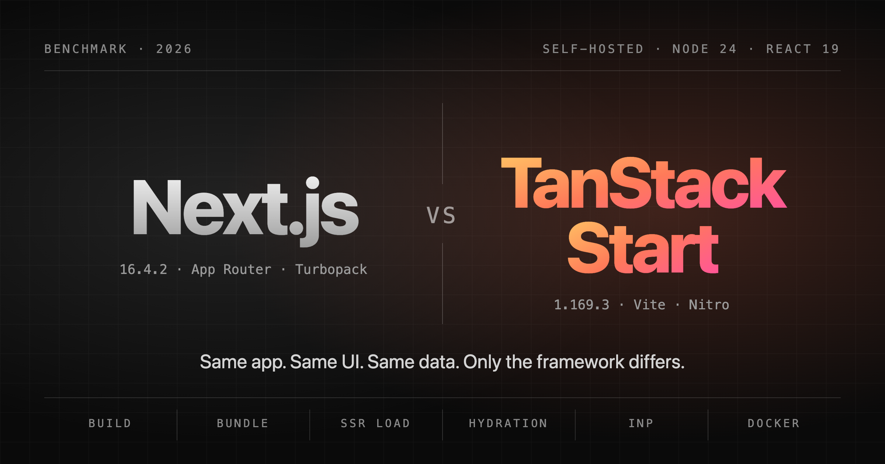

# Next.js vs TanStack Start benchmark



Two apps with the same pages, the same React components and the same data. Only the framework differs.

|                                 | Version                                                      |
| ------------------------------- | ------------------------------------------------------------ |
| Next.js (App Router, Turbopack) | 16.4.2                                                       |
| TanStack Start (Vite, Nitro)    | 1.169.3 (router 1.170.45, Vite 8.3.4, Nitro 3.0.260903-beta) |
| React                           | 19.3.1                                                       |
| Tailwind CSS                    | 4.3.3                                                        |
| Node / pnpm                     | 24.22.1 / 12.14.0                                            |

Every dependency is pinned to an exact version and is at least 7 days old (`minimumReleaseAge` in `pnpm-workspace.yaml`, checked by `pnpm policy`).

## Layout

```
apps/next       Next.js app (App Router)
apps/start      TanStack Start app
packages/ui     shared React components + Tailwind theme (links come in as a prop)
packages/data   deterministic in-memory data: no database, no network
scripts/        benchmarks, smoke test, report
tools/          repository rules (`pnpm policy`) and project lint rules
results/        raw results (JSON) written by the benchmarks
Dockerfile      one image per app, same base and runtime settings
METHODOLOGY.md  how every number is measured, and what is the same in both apps
```

## Results

No published results yet. Running the benchmarks writes the raw data to `results/*.json` and a readable summary to `RESULTS.md`.

## Pages

| Route                            | Rendering (both apps)                          | What it measures                                                        |
| -------------------------------- | ---------------------------------------------- | ----------------------------------------------------------------------- |
| `/`                              | prerendered                                    | baseline, framework JS                                                  |
| `/blog`, `/blog/[slug]`          | prerendered, 200 posts                         | build time with many pages, static serving                              |
| `/products?q&category&sort&page` | SSR on every request                           | server rendering with search params                                     |
| `/products/[id]`                 | SSR on every request, review form              | dynamic route, data loading, mutation (server action / server function) |
| `/dashboard`                     | prerendered, 5,000 rows hydrated on the client | hydration, TBT, interaction latency                                     |
| `/api/search?q=`                 | route handler / server route                   | raw API throughput                                                      |

## Run it

Requirements:

- Node **24.22.1** exactly (`.node-version`; pnpm refuses other versions) and pnpm 12.14.0
- Google Chrome installed: the browser benchmark drives it headless, with its own temporary profile
- Docker Desktop running: `bench:docker` builds and starts the images
- free ports 3001–3002 (dev servers), 4101–4102 (production servers and containers), 4201–4202 (compressing proxy)

```bash
pnpm install
```

```bash
pnpm build && pnpm bench:smoke
```

```bash
pnpm bench:all
```

`bench:all` runs everything with the default sample sizes and writes `RESULTS.md`. It takes about 4.5 hours on an Apple M5 Pro (load test ~2 h, browser ~2 h, the rest ~25 min). If a step fails, the steps before it keep their results; run the remaining ones on their own. While iterating, run the parts with fewer samples:

| Command                                    | Measures                                                                                                                                                                                    | Default               |
| ------------------------------------------ | ------------------------------------------------------------------------------------------------------------------------------------------------------------------------------------------- | --------------------- |
| `pnpm bench:build --runs 10`               | cold and warm `build`                                                                                                                                                                       | 10 runs               |
| `pnpm bench:bundle`                        | first-load JS/CSS/HTML per route (raw, gzip, brotli)                                                                                                                                        | 1 run (deterministic) |
| `pnpm bench:dev --runs 5 --hmr 5`          | dev cold start, first compile, HMR, memory                                                                                                                                                  | 5 × 5                 |
| `pnpm bench:docker --runs 30`              | image size, container start, first SSR request                                                                                                                                              | 30 runs               |
| `pnpm bench:load --duration 60 --rounds 3` | req/s, p50/p90/p99, memory, CPU at 10/50/100 connections                                                                                                                                    | 60 s × 3 rounds       |
| `pnpm bench:load --target docker`          | the same, inside the containers started with `--cpus 2 --memory 1g` (not in `bench:all`)                                                                                                    |                       |
| `pnpm bench:lighthouse --runs 30`          | Lighthouse load metrics (TTFB, FCP, LCP, TBT, CLS, JS execution, bytes, requests), then interaction latency and duration measured in a separate page without Lighthouse; desktop and mobile | 30 runs               |
| `pnpm bench:report`                        | `results/*.json` → `RESULTS.md`                                                                                                                                                             |                       |

Close other apps (editors included), plug in the power, keep the machine awake (`caffeinate -i pnpm bench:all` on macOS) and idle while it runs, and check first that nothing from an earlier run is still alive on the ports above. See [METHODOLOGY.md](METHODOLOGY.md) for how each number is taken and what is deliberately the same in both apps.
